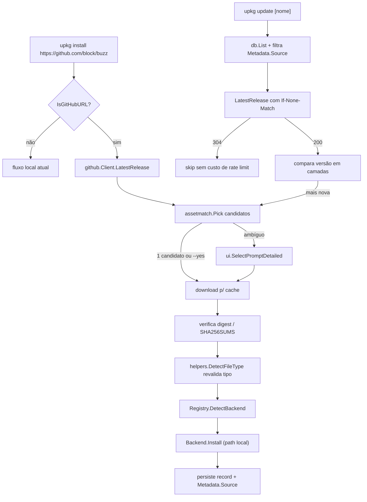

# Report: instalação por URL do GitHub + `upkg update`

**Data:** 2026-08-06 · **Escopo:** análise e design (nenhum código de produto foi alterado)
**Método:** 6 agentes paralelos — mapa de integração no código, API GitHub (fonte primária), prior art (9 ferramentas lidas em código-fonte), matching de asset (dados reais de 8 repositórios), semântica de update, revisão de segurança.

---

## 1. Veredito

O recurso é viável e **encaixa na arquitetura atual sem alterar a interface `Backend`**. A razão é estrutural: `Backend.Install(ctx, packagePath string, opts, tx)` (`internal/backends/backend.go:22`) recebe um **caminho local**. Basta transformar `https://github.com/block/buzz/` em um arquivo baixado e verificado em cache, e todo o pipeline existente (`DetectBackend` → `Install` → `ReplaceByPath` → rollback/commit) continua valendo palavra por palavra.

Três fatos determinam o desenho:

| Fato verificado | Consequência |
|---|---|
| Não existe camada de rede: nenhum `net/http` em `internal/` ou `cmd/` | TLS, redirect, timeout, cap de bytes e anti-SSRF precisam ser escritos do zero — é a maior parte do risco novo |
| Já existe precedente de entrada não-arquivo: `flatpak.IsFlatpakAppID` faz bypass de `filepath.Abs`/`ValidatePath`/`os.Stat` em `internal/cmd/install.go:64,66,81,96` | `IsGitHubURL` entra exatamente no mesmo lugar, sem reescrever `RunE` |
| Já existe substituição atômica reversível: `(*Manager).BackupForReplace` (`internal/transaction/replacement.go:51`) + `db.ReplaceByPath` (`internal/db/db.go:334`) + finalizadores de commit (`manager.go:51`, `:104`) | `upkg update` é "install com `Force=true`" e herda rollback correto de graça — esse trabalho foi feito na correção do BUG-001 |

O que **não** é viável sem quebrar uma invariante: atualizar `.deb`/`.rpm` automaticamente. Esses caminhos terminam em `sudo pacman -U --noconfirm` (`internal/syspkg/arch/pacman.go:38-53`), e com `Overwrite` viram `--overwrite '*'`, que remove a última barreira do pacman contra conflito de arquivos. Instalar como root um artefato baixado de uma URL arbitrária, sem interação, é escalonamento de privilégio por design. Ver §9.

---

## 2. Estado atual — o que existe e o que falta

### 2.1 Já pronto (reaproveitável sem mudança)

| Peça | Local | Uso no recurso |
|---|---|---|
| Detecção por assinatura de conteúdo | `internal/helpers/detection.go:39` `DetectFileType` (512 bytes, magic + `ustar` no offset 257, probe de descompressão) | **Juiz final** do tipo do artefato baixado. O nome do asset é controlado pelo atacante; a extensão é só *hint* de ranking |
| Registry com prioridade | `internal/backends/backend.go:60-85` (flatpak → deb → rpm → appimage → binary → tarball) | `DetectBackend(ctx, downloadedPath)` continua decidindo o backend |
| Transação LIFO + finalizadores de commit | `internal/transaction/manager.go` — `Add:43`, `AddCommit:51`, `Rollback:59`, `Commit:104` | Rollback do update |
| Backup por rename de sibling | `internal/transaction/replacement.go:51` (`.<base>.upkg-backup-<uuid>` em `:62`; rollback restaura, commit descarta) | Troca atômica do binário/dir instalado |
| `ReplaceByPath` preservando ID/data canônicos | `internal/db/db.go:334-410` | Update mantém `InstallID` e `install_date` originais |
| Metadata JSON extensível e tolerante | `internal/core/models.go:47-76` (`UnmarshalJSON` custom, ignora chaves desconhecidas) | Persistência da origem sem migração de schema |
| Prompt detalhado | `internal/ui/prompt.go:77` `SelectPromptDetailed` | Menu "escolha o pacote compatível" |
| Scorer em camadas com testes tabelados | `internal/heuristics/` | Modelo a espelhar para o matcher de asset |
| Limites anti-bomba de extração | `internal/helpers/archive.go:19-23` (10 GB / 100k arquivos / ratio 1000 / 5 GB por arquivo) | Teto de sanidade — precisa de orçamento menor para artefato remoto |
| `CommandRunner` injetado | `internal/helpers/exec.go` | `gh auth token` testável sem rede |

### 2.2 Lacunas reais

1. **Rede: zero.** Sem cliente HTTP, sem cache de download, sem retry, sem rate-limit awareness.
2. **`security.ValidatePath` é um no-op para URLs.** `internal/cmd/install.go:82` chama a versão fraca (`internal/security/paths.go:81-93` — só null byte e comprimento ≤ 4096). O validador forte `ValidateFilePath` (`internal/security/validation.go:101-172`) **não** está nesse caminho. Nenhum ponto do código valida esquema ou host hoje.
3. **`ValidatePackageName` aceita `.` e `..`.** `ValidPackageNameRegex = ^[a-zA-Z0-9._-]+$` (`internal/security/validation.go:10-12`) casa `..`; a lista de padrões suspeitos só cobre `"../"` (`:46-62`). Hoje o nome vem de arquivo local ou `--name`; com URL passa a derivar de string remota e alimenta `filepath.Join(binDir, name)` (`internal/backends/tarball/tarball.go:167-190`).
4. **Modos de arquivo do archive aplicados verbatim.** `header.FileInfo().Mode()` para dirs e arquivos regulares no tar (`internal/helpers/archive.go:170,180`) e `f.Mode()` no zip (`:260,296`) — setuid/setgid e dir `0777` de dentro do artefato chegam ao disco.
5. **`applyMigrations` só carimba versão.** `internal/db/db.go:112-130` grava `currentSchemaVersion = 1` e não tem máquina de `ALTER TABLE`. Qualquer coluna nova exige construir isso primeiro.
6. **`gosec` G204 desabilitado globalmente** (`.golangci.yml:23-25`) — novos sinks de exec alimentados por string remota não geram alerta.

---

## 3. Arquitetura proposta



### 3.1 Pacotes novos

```
internal/
├── source/
│   └── github/
│       ├── client.go      # HTTP hardened: TLS≥1.2, allowlist, 5 redirects, cap de bytes
│       ├── release.go     # LatestRelease, ReleaseByTag, ListReleases (paginado)
│       ├── url.go         # IsGitHubURL, ParseRepoURL  (espelha flatpak/detect.go:16-33)
│       ├── token.go       # UPKG_GITHUB_TOKEN → GH_TOKEN → GITHUB_TOKEN → `gh auth token`
│       └── download.go    # download p/ cache, dir 0700 + arquivo 0600 O_EXCL, digest
├── assetmatch/
│   ├── models.go          # Asset, Target, Candidate  (espelha heuristics/models.go)
│   ├── normalize.go       # aliases de OS/arch/libc
│   ├── exclude.go         # checksums, sigs, debug, source, vendor, zsync
│   └── picker.go          # Pick() em camadas + desempate determinístico
└── version/
    └── compare.go         # semver → data → natural → published_at
```

`internal/cmd/update.go` com `NewUpdateCmd(cfg, log)`, registrado em `internal/cmd/root.go:19-25` ao lado dos demais.

### 3.2 O que **não** muda

- `Backend` interface (`backend.go:25-35`) — nenhum backend sabe que existe rede.
- Nenhum SQL novo (ver §6 — decisão de persistir em `Metadata`).
- Nenhuma mudança na detecção por conteúdo.

---

## 4. UX e CLI

### 4.1 Install por URL

```bash
upkg install https://github.com/block/buzz            # menu de assets compatíveis
upkg install block/buzz                                # forma curta (owner/repo)
upkg install https://github.com/block/buzz --yes       # melhor candidato, sem prompt
upkg install block/buzz --format appimage              # filtra formato
upkg install block/buzz --asset 'amd64\.deb$'          # regex sobre o nome
upkg install block/buzz --tag desktop-v0.5.4           # tag específica
upkg install block/buzz --prerelease                   # inclui prereleases
```

Menu, com dados reais do release `desktop-v0.5.5` (verificado na API em 2026-08-06), numa máquina `linux/amd64/glibc`:

```
? Select package to install for linux/amd64 (2 compatible of 11 assets):
▸ Buzz_0.5.5_amd64.deb        deb      | amd64 | 108 MB | requires sudo
  Buzz_0.5.5_amd64.AppImage   appimage | amd64 | 166 MB | user-space
  ─────
  Show all 11 assets
```

Os 9 restantes são descartados com motivo registrado em log de debug: 5 são `darwin`/`windows` (`.dmg`, `.exe`, `x64.app.tar.gz`, `aarch64.app.tar.gz`), 4 são `.sig`. **Este release é a melhor demonstração da armadilha**: `Buzz_0.5.5_x64.app.tar.gz` é um bundle macOS que um matcher ingênuo de "tarball + x64" escolheria — o token `.app` e a ausência de `linux` são o que o rejeitam.

### 4.2 Update

```bash
upkg update                    # todos os registros com origem GitHub
upkg update buzz               # só um, por nome
upkg update --dry-run          # mostra o que mudaria
upkg update --check            # só verifica, exit 1 se há update (padrão appimageupdatetool)
upkg update --yes              # sem confirmação (só caminhos sem sudo)
upkg update buzz --allow-downgrade
upkg update --hold buzz        # congela; --unhold libera
```

Espelha o padrão já estabelecido por `internal/cmd/uninstall.go`: seleção por nome, `--all`, `--yes`, `--dry-run`, agregação de resultados por registro e sumário final — uma falha em um pacote não aborta os demais.

```
Checking 4 packages for updates...

  buzz        0.5.4  →  0.5.5      appimage   166 MB
  ripgrep     15.2.0 →  15.2.0     up to date
  zed         0.9.1  →  0.9.4      tarball     94 MB
  lapce       —                    held

Update 2 packages (260 MB)? [y/N]
```

---

## 5. Seleção de asset

Pipeline em camadas, com **exclusão antes de pontuar** — a ordem importa porque `nvim-linux-x86_64.appimage.zsync` casaria arch e OS perfeitamente.

### 5.1 Exclusões duras (regex sobre o nome)

`.sha256|.sha512|.md5` · `.sig|.asc|.minisig` · `checksums?|shasums?` · `-debug|-dbg|-symbols|.pdb` · `sources?|.src.tar` · `vendor` · `.zsync|.torrent` · `sbom|provenance`

Depois, exclusão semântica: OS ≠ alvo descarta; arch ≠ alvo e ≠ `universal/any` descarta. `libc` **não** descarta — apenas penaliza (glibc roda sob glibc; musl-only em sistema glibc é o caso ruim).

### 5.2 Pontuação

| Sinal | Peso |
|---|---:|
| OS exato | +400 |
| Arch exato | +300 |
| Arch universal/`any` | +100 |
| libc exato | +60 |
| Formato preferido pela distro (`/etc/os-release`) | +90 / +80 |
| AppImage | +70 |
| tar.gz genérico | +30 |
| zip | +20 |
| Nome do app presente | +15 |
| musl-only em glibc | −40 |
| `unsigned`/`alpha` no nome | −10 |
| < 1 MB (helper, ex. `bwrap-linux-x86_64.gz` do zed) | −5 |

Validado contra dados reais: em amd64/glibc, `Buzz_0.5.5_amd64.deb` = 865 vence `Buzz_0.5.5_amd64.AppImage` = 845; `ripgrep-…-linux-gnu.tar.gz` = 830 vence a variante musl = 790, e o inverso ocorre em Alpine.

### 5.3 Desempate

- 1 candidato → instala direto.
- Vencedor com score ≥ 60 **e** vantagem ≥ 40 sobre o segundo → instala direto com `--yes`; **sem** `--yes`, mostra o menu (é o que o usuário pediu).
- Empate (ex. os 6 `.deb` de distro do lapce: `lapce.debian.bookworm.amd64.deb`, `…ubuntu.noble.arm64.deb`, …) → menu obrigatório; em script, `--asset` resolve.
- Nada casa → lista todos os assets com o motivo da exclusão e sugere `--asset`, espelhando `createDetectionError` (`backend.go:95`). Nunca aborta em silêncio.
- **A escolha do usuário é persistida** e reusada no update seguinte (lição do `custom_release_words` do install-release e do campo `asset` do stew).

### 5.4 Defesa contra nome mentiroso

Um asset chamado `foo.deb` que na verdade é um tarball é pego por `helpers.DetectFileType` **depois** do download. Divergência entre o formato prometido pelo nome e o tipo real ⇒ **abortar**, não reclassificar em silêncio. Sem isso, um nome remoto controlado pelo atacante escolheria qual código roda com `sudo`.

---

## 6. Modelo de dados de origem

**Decisão: persistir em `core.Metadata`, sem migração de schema.**

```go
// internal/core/models.go — campo novo em Metadata
type Metadata struct {
    // … campos existentes …
    Source *SourceRef `json:"source,omitempty"`
}

type SourceRef struct {
    Kind         string    `json:"kind"`           // "github"
    Owner        string    `json:"owner"`
    Repo         string    `json:"repo"`
    RepoID       int64     `json:"repo_id"`        // imutável: pin anti-sequestro
    Tag          string    `json:"tag"`            // "desktop-v0.5.5"
    Version      string    `json:"version"`       // "0.5.5" normalizado
    AssetName    string    `json:"asset_name"`
    AssetDigest  string    `json:"asset_digest,omitempty"`  // "sha256:…"
    DownloadURL  string    `json:"download_url"`
    PublishedAt  time.Time `json:"published_at"`
    Prerelease   bool      `json:"prerelease"`
    ETag         string    `json:"etag,omitempty"`
    CompareMode  string    `json:"compare_mode"`   // semver|date|natural|published
    Hold         bool      `json:"hold,omitempty"`
}
```

**Por que JSON e não colunas v2:** `Metadata.UnmarshalJSON` (`models.go:57-76`) já tolera chaves desconhecidas, e `ReplaceByPath` (`db.go:334`) + `convert.ToInstallRecord` (`convert.go:16-44`) já propagam o metadata intacto — custo de integração ≈ zero. `applyMigrations` (`db.go:112-130`) hoje **só carimba a versão**: adicionar colunas exige construir a máquina de `ALTER TABLE` idempotente e tocar 5 statements SQL (`Create`, `Get`, `List`, `Update`, `ReplaceByPath`) antes de escrever uma linha do recurso.

**Tradeoff explícito:** origem em JSON não é indexável. `upkg update` faz `db.List()` e filtra em Go — correto para dezenas de registros, e é exatamente o que `uninstall.go` já faz. No dia em que `upkg list --source github` precisar de filtro no SQL, aí sim vale migração v2 com coluna gerada — e essa é a hora de construir a máquina de migração, com o benefício real na mão.

---

## 7. Detecção de nova versão

O ponto mais fácil de errar. `desktop-v0.5.5` já mostra três armadilhas simultâneas no mesmo repositório: prefixo de monorepo, **mudança de esquema de tag no meio da vida** (`v0.5.2` → `desktop-v0.5.3`) e uma tag rolante de prerelease (`sprig-latest`). A listagem da API também **não vem ordenada por versão**.

### 7.1 Comparação em camadas

1. **semver** — strip de prefixo (`v`, `release-`, `<componente>-v`), parse `major.minor.patch[-pre][+build]`. Prerelease ordena antes do release (`1.0.0-rc1 < 1.0.0`). Se ambos os lados parseiam ⇒ decisão confiável.
2. **data** — `2024.01.15`, `20240115`, `2024-01-15` ⇒ comparação cronológica.
3. **natural/numérico** — segmentos numéricos comparados como números, não strings. Isto é o que impede o clássico `1.64.0 < 1.9.0`.
4. **`published_at`** — fallback final para tags opacas (hashes, build numbers). É o que eget e install-release usam na prática.

**Só afirmar "há atualização" quando:** a tag difere **e** (a camada que decidiu é 1–3 e diz *maior*, **ou** a camada é 4 e `published_at` é estritamente mais recente). Tag igual com digest diferente **não** é update — é release editada in-place, tratada como incidente de integridade (§9). O `CompareMode` usado no install é gravado no registro; mudança de esquema de tag (`v0.5.2` → `desktop-v0.5.3`) rebaixa para camada 4 e pede confirmação em vez de decidir sozinha.

Downgrade é recusado salvo `--allow-downgrade`.

### 7.2 Requisições condicionais — o que faz `upkg update` escalar

- `GET /repos/{owner}/{repo}/releases/latest` com `If-None-Match: <etag salvo>`.
- **304 não conta no rate limit primário**, mas *somente* se a requisição levar `Authorization` válido (docs oficiais, verbatim). Sem token, o 304 conta.
- Sem auth: **60 req/h por IP**. Com token: **5.000/h**. Requisições seriais (recomendação oficial contra o limite secundário de 100 concorrentes).
- Polls devem ser **estáveis**: mudar `per_page`/`page` entre chamadas muda o ETag e quebra o 304.

Consequência prática: com `UPKG_GITHUB_TOKEN` no ambiente, `upkg update` com 40 pacotes inalterados custa **0** do rate limit. Sem token, o mesmo comando gasta 40 dos 60 disponíveis na hora.

### 7.3 Armadilha do `releases/latest`

`releases/latest` filtra **non-prerelease, non-draft** e ordena por `created_at` (data do *commit* da release, não da publicação). Repositório cuja única release publicada é prerelease retorna **404** mesmo tendo releases. Fallback: `GET /releases?per_page=1`.

### 7.4 Headers obrigatórios

`User-Agent` é **obrigatório** — ausente ⇒ requisição rejeitada; inválido ⇒ `403`. Mais `Accept: application/vnd.github+json` e `X-GitHub-Api-Version: 2022-11-28`.

---

## 8. Atualização atômica

O caminho já existe e foi endurecido na correção do BUG-001:

1. Download para dir temp `0700` no **mesmo filesystem** do destino, arquivo `0600` com `O_EXCL`.
2. Verifica digest/checksum. **Só então** marca `+x`.
3. `helpers.DetectFileType` revalida o tipo; `Registry.DetectBackend` escolhe o backend.
4. `Backend.Install(..., Force: true, tx)` — o backend chama `tx.BackupForReplace`, que renomeia o alvo para `.<nome>.upkg-backup-<uuid>`. Falha ⇒ `Rollback` restaura o binário anterior; sucesso ⇒ finalizador de `Commit` descarta o backup.
5. `db.ReplaceByPath` preserva `InstallID` e `install_date`; `Metadata.Source` recebe tag/digest/ETag novos.
6. `defer os.RemoveAll(tmpDir)` incondicional **e** hook `tx.Add`, para não deixar artefato não verificado em disco após rollback.

**Nunca** truncar in-place: `O_TRUNC` sobre um binário em execução dá `ETXTBSY` ou corrupção. `rename(2)` no mesmo FS é a única troca segura — é o que AppImageUpdate faz (escreve ao lado, troca depois) e o que o topgrade contorna re-executando o próprio binário.

---

## 9. Segurança

A mudança de vetor é qualitativa: hoje o usuário **escolhe um arquivo local**; com o recurso, **uma string de URL** dispara download, seleção, extração e escrita em `~/.local/bin` (que está no `PATH`) mais um `.desktop` com `Exec=` — execução de código por design, recorrente a cada `upkg update`.

### 9.1 MUST — bloqueantes

1. **HTTPS obrigatório**, TLS ≥ 1.2, verificação de cadeia sempre; `InsecureSkipVerify` não deve existir no código, nem atrás de flag. Rejeitar `http` na entrada **e em cada redirect** — um `301` de `https` para `http` aborta.
2. **Allowlist de hosts** (`github.com`, `api.github.com`, `objects.githubusercontent.com`, `*.githubusercontent.com`) **mais** `Control` no `net.Dialer` rejeitando IP resolvido em faixa privada/loopback/link-local/CGNAT/ULA/IPv4-mapped. Checagem só de string não fecha DNS-rebinding entre resolução e conexão.
3. **Máx. 5 redirects**, revalidando esquema e host a cada salto. `Authorization` anexado **por requisição, nunca no `RoundTripper`** — a stdlib do Go remove headers sensíveis em redirect cross-domain (`net/http/client.go:39-50`), mas essa proteção não existe para um transport custom com token embutido. O download real sai de `*.githubusercontent.com`, host diferente de `api.github.com`.
4. **Timeouts** de dial (10s), TLS handshake (10s) e response header (30s), mais deadline global via `context` reusando a flag `--timeout` existente. **Cap de download** por `io.LimitReader`, default 512 MiB, checado também contra `Content-Length` antes de ler. Atingir o limite é erro, nunca truncamento silencioso.
5. **Digest do asset** registrado no install e revalidado em todo update. A API expõe `digest` (`sha256:<hex>`, nullable). Tag igual + digest diferente ⇒ **abortar como comprometimento**. É o controle mais barato e o único que detecta release editada in-place.
6. **Checksum/assinatura presente e inválida ⇒ falha dura**, nunca warning. Exigir assinatura não é realista (cobertura minoritária em releases do GitHub, e nenhuma das 9 ferramentas de prior art verifica `.sig` externo); verificar quando presente é obrigatório.
7. **TOFU com pin**: `owner`, `repo`, `repo_id` numérico (imutável — sobrevive a rename/transferência, ao contrário de `owner/repo`, que o GitHub redireciona), padrão do nome do asset. Mudança ⇒ parar e exigir confirmação, imprimindo o delta.
8. **Isolamento do artefato**: dir `0700`, arquivo `0600` `O_EXCL`, nunca `/tmp` com nome previsível; sem bit de execução antes da verificação. O AppImage já tem o precedente correto (extrai via `unsquashfs` lendo a origem `0644` sem executá-la, `appimage.go:396-436`).
9. **Revalidar tipo por conteúdo**; divergência com o prometido ⇒ abortar.
10. **Sanitizar modes na extração** — mascarar `0755`/`0644` e limpar `setuid|setgid|sticky`. Hoje o mode vem do artefato sem máscara (`archive.go:170,180` no tar; `:260,296` no zip). Um dir `0777` sob `~/.local/share/upkg/apps/<x>` permite que outro usuário local plante o binário que o wrapper no `PATH` executa.
11. **Substituição atômica** por `rename` no mesmo FS + `BackupForReplace`.
12. **Token nunca em TOML.** `config.Load()` lê `~/.config/upkg/config.toml` via viper sem impor permissão (`internal/config/config.go:40-58`), e não há `WriteConfig` no código — o arquivo nasce com o umask do usuário, tipicamente `0644`. Ordem de resolução: `UPKG_GITHUB_TOKEN` → `GH_TOKEN` → `GITHUB_TOKEN` → `gh auth token --hostname github.com` (via `CommandRunner`, saída nunca logada). Escopo **zero** para repositório público — o token serve só para rate limit. Redigir em qualquer log ou mensagem de erro.
13. **`sudo` nunca automático a partir de origem remota.** DEB/RPM via pacman exigem confirmação explícita por instalação e ficam **fora** de `upkg update --yes`; `--overwrite '*'` (`pacman.go:43`) deve ser **proibido** para origem remota, não apenas confirmado.
14. **Endurecer o nome derivado de string remota**: rejeitar `.`, `..` e nomes iniciados por `-` em `ValidatePackageName`; hoje o regex os aceita.
15. **Bloquear shadowing do `PATH`** sem confirmação: um asset cujo nome derive para `sudo`, `git`, `ls` grava um `0755` em `~/.local/bin` que precede `/usr/bin` no `PATH` da maioria das configurações.

### 9.2 SHOULD

Orçamento de extração dedicado a artefato remoto (ex. 2 GB / 20k arquivos), mais restrito que os tetos globais · verificar `SHA256SUMS`/`checksums.txt` do mesmo release casando o nome exato (integridade de canal, **não** autenticidade — vem do mesmo canal que o asset) · exibir origem/versão/digest em `upkg list`/`upkg info` para auditoria · recusar downgrade sem flag · isolar falhas no update em massa e pular pacotes que exigiriam `sudo` · reativar `gosec` G204 ao menos para os pacotes novos · `min-age-days` opcional (padrão do ubi) contra supply-chain de release recém-publicada.

### 9.3 O que fica automático

Update de repo já pinado, mesmo `owner/repo/repo_id`, versão maior por camada confiável, digest verificado, e backend **sem `sudo`** — AppImage, Binary, Tarball, todos escrevendo apenas sob `$HOME`. Esse é o caso do `block/buzz` via AppImage.

---

## 10. Prior art

Nove ferramentas lidas em código-fonte. Nenhuma resolve o problema inteiro; as lições vêm de peças diferentes.

| Ferramenta | Escolha de asset | Desempate | Detecta update? | Estado | Integridade |
|---|---|---|---|---|---|
| **eget** | regex OS/arch, prioridade `.appimage` | prompt ao usuário | mtime local vs `created_at` | nenhum | `.sha256`/`.sha256sum` automático |
| **ubi** | allowlist ext → OS → arch → libc (`ldd /bin/ls`) | sort por nome (determinístico) | não (one-shot) | nenhum | **nenhuma** |
| **stew** | regex OS/arch, fallback darwin-arm→amd64 | prompt | `tag != lockfile.tag` | `Stewfile.lock.json` | hash do binário instalado |
| **install-release** | scorer com pesos/penalidades + distro via `/etc/os-release` | score ≥ 0.2, senão prompt | `published_at` | state JSON | **nenhuma** |
| **AppImageUpdate** | update info embutido (`.upd_info`) | fnmatch da spec | zsync SHA-256 delta | o arquivo é o state | **GPG embutida** + detecção de troca de chave |
| **Homebrew cask** | cask declara URL/arch | — | `Version` token-compare; `:latest` → sha do download | metadata dir | `sha256` obrigatório (política) |
| **nix-update** | N/A (hash por rev) | — | `version_compare` estilo RPM | imutável | SRI verificado |
| **gh-release-install** | regex→template de URL | prefixo literal mais longo | não | nenhum | nenhuma |
| **topgrade** | delega | — | crate `self_update` + re-exec | arquivo keep | não |

**Lições que entram no design:**

1. Sem estado persistente, não existe update de verdade — eget/ubi/ghri não têm. O upkg já tem o DB; só falta a origem.
2. Comparar **string de tag** quebra (`1.64.0` vs `1.9.0`); comparar por **data** é o que funciona na prática para tags opacas.
3. Desempate **determinístico** (ubi ordena por nome) evita que o mesmo comando instale coisas diferentes em máquinas iguais.
4. Persistir a escolha manual do usuário (`custom_release_words` do install-release) — sem isso, o update reabre o menu toda vez.
5. Prompt só quando inevitável, **nunca** no modo em massa (stew usa exclude list; install-release faz checagem paralela + uma confirmação única).
6. Nunca sobrescrever binário em uso: AppImageUpdate escreve ao lado e troca; topgrade re-executa.
7. `--min-age-days` do ubi é o único controle de supply-chain barato contra release recém-comprometida.
8. Falso-positivo de arch em versão dentro do nome (`project-1.64.0.tar.gz`), `linuxstatic`, `win64` dentro do regex de x86_64 — os casos de teste do ubi (130+ com rstest) são a melhor base para a tabela de testes.

**Caso especial AppImage — zsync.** A spec `gh-releases-zsync|user|repo|tag|pattern` embutida em `.upd_info` casa exatamente com o modelo "instalei de um release do GitHub", permite delta (baixar só blocos alterados de um AppImage de 166 MB) e traz assinatura GPG real. Mas: (a) exige update info embutido, e **electron-builder não gera** — a maioria dos AppImages de apps Electron não é atualizável assim; (b) embutir zsync2/gpgme (C++) no upkg é inviável. Encaminhamento: se o AppImage instalado tiver `.upd_info` e `appimageupdatetool` existir no host, oferecer o caminho delta como subprocesso opcional; senão, download completo. Fora do v1.

---

## 11. Plano de implementação

Cada fase é entregável e testável isoladamente. Os testes seguem a convenção do repo: `testify`, tabelas com `t.Run` + `t.Parallel()`, `afero.NewMemMapFs`, `helpers.MockCommandRunner`, `paths.NewResolverWithHome(cfg, t.TempDir())` — **nunca** `os.Setenv("HOME")`.

| Fase | Entrega | Arquivos | Testes |
|---|---|---|---|
| **1** | `internal/version/compare.go` — comparação em camadas | 1 novo | Tabela com `desktop-v0.5.5`, `v0.5.2`, `1.64.0` vs `1.9.0`, `2024.01.15`, `release-123`, prerelease |
| **2** | `internal/assetmatch/` — normalize, exclude, picker | 4 novos | Tabelas com os 11 assets reais do buzz, 8 do ripgrep, 6 `.deb` do lapce; alvos amd64/arm64/musl |
| **3** | `internal/source/github/` — cliente hardened + release + token | 5 novos | `httptest.Server` para redirect cross-host, `http`→abort, cap de bytes, 304, 403 rate-limit, `Retry-After`; dialer rejeitando IP privado |
| **4** | `security`: rejeitar `.`/`..`/prefixo `-`; `archive`: mascarar modes | `validation.go`, `archive.go` | Regressão: `..` rejeitado; tar com setuid → mode mascarado |
| **5** | `SourceRef` em `core.Metadata` | `models.go` | Round-trip JSON; registro legado sem `source` continua carregando |
| **6** | Wiring do install: `IsGitHubURL` no bypass, download, menu, persistência | `internal/cmd/install.go` | Cobra `Execute` com `SetArgs`, buffer de saída, servidor fake — padrão de `install_test.go` |
| **7** | `upkg update` | `internal/cmd/update.go`, `root.go` | Um registro por camada de comparação; 304 → skip; falha isolada em lote; `--hold`; `--dry-run`; recusa de downgrade |
| **8** | Confirmação de `sudo`, proibição de `--overwrite` remoto, exibição de origem em `list`/`info` | `install.go`, `pacman.go`, `list.go`, `info.go` | Backend deb com origem remota exige confirmação |
| **9** | Docs + `make validate` + e2e com fixture de servidor local | `AGENTS.md`, `README.md`, `scripts/e2e-test.sh` | `gofmt -s`, `go vet`, `golangci-lint run`, `go test -race ./...` |

Fases 1–5 são independentes entre si e paralelizáveis; 6 depende de 1–5; 7 depende de 6.

---

## 12. Riscos e decisões abertas

| Risco | Mitigação / decisão |
|---|---|
| Escrever um cliente HTTP seguro do zero é o maior risco novo do projeto | Concentrar em um único pacote com testes de `httptest` para cada controle (redirect, esquema, cap, timeout, dialer); nunca expor `*http.Client` para outros pacotes |
| Rate limit anônimo (60/h) faz `upkg update` falhar em uso normal | Suportar token desde o dia 1 e ETag condicional; `upkg doctor` mostra `GET /rate_limit` (não conta no primário) |
| Heurística de asset errando em silêncio | Desempate determinístico + menu quando ambíguo + escolha persistida + `--asset` como escape hatch; log de debug com o motivo de cada exclusão |
| `.deb`/`.rpm` de origem remota via `sudo` | **Fora do update automático.** Confirmação explícita por instalação; `--overwrite '*'` proibido para origem remota |
| Tags opacas gerando update fantasma ou downgrade | Só afirmar update com camada confiável ou `published_at` estritamente maior; `CompareMode` gravado; downgrade recusado sem flag |
| Monorepo com múltiplos componentes na mesma tag (`desktop-v0.5.5`, `sprig-latest`) | Gravar o prefixo do componente derivado da tag do install e exigir o mesmo prefixo no update; prefixo diferente ⇒ não é candidato |
| Migração de schema adiada | Decisão consciente: origem em `Metadata` JSON. A máquina de `ALTER TABLE` só entra quando houver necessidade real de índice, com o benefício na mão |

**Decisões que dependem do usuário:**

1. **`upkg update` toca `.deb`/`.rpm`?** Recomendação: não no v1 — exibe "update disponível, rode `upkg install <url>` para aplicar com sudo".
2. **Prerelease por padrão?** Recomendação: não; flag global mais por-app no registro.
3. **`upkg install <url>` sem subcomando** (o exemplo do enunciado é `upkg https://github.com/block/buzz/`)? Recomendação: manter `install` explícito e aceitar a forma curta `owner/repo`; um argumento posicional solto no root colide com a descoberta de subcomandos do Cobra.

---

## 13. Fontes

**Código do repositório** — verificado arquivo:linha ao longo do documento.

**API GitHub** (fonte primária): OpenAPI descriptor oficial `github/rest-api-description` v1.1.4 (`api.github.com.json`, paths de releases e schema `release-asset`) · [rate limits](https://docs.github.com/en/rest/using-the-rest-api/rate-limits-for-the-rest-api) · [best practices — 304 e redirects](https://docs.github.com/en/rest/using-the-rest-api/best-practices-for-using-the-rest-api) · [autenticação](https://docs.github.com/en/rest/authentication/authenticating-to-the-rest-api) · [credenciais seguras](https://docs.github.com/en/rest/authentication/keeping-your-api-credentials-secure) · [User-Agent e Accept](https://docs.github.com/en/rest/using-the-rest-api/getting-started-with-the-rest-api) · [versões da API](https://docs.github.com/en/rest/about-the-rest-api/api-versions) · [gh CLI: env e auth](https://cli.github.com/manual/gh_help_environment) · Go stdlib `net/http/client.go:39-50`.

**Dados reais coletados em 2026-08-06:** releases e assets de `block/buzz` (`desktop-v0.5.5`, 11 assets, histórico de 15 tags), `BurntSushi/ripgrep`, `cli/cli`, `syncthing/syncthing`, `neovim/neovim`, `zed-industries/zed`, `lapce/lapce`, `starship/starship`.

**Prior art lido em código-fonte:** `zyedidia/eget` (detect.go, verify.go, eget.go, find.go) · `houseabsolute/ubi` (picker.rs, builder.rs, forge.rs) · `marwanhawari/stew` (cmd/upgrade.go, lib/stewfile.go, lib/github.go) · `shibataka000/gh-release-install` (pattern.go) · `Rishang/install-release` (release_scorer.py, cli_interact.py) · `AppImageCommunity/AppImageUpdate` (updater.cpp, updatableappimage.cpp, GithubReleasesZsyncUpdateInformation.cpp, cli/main.cpp) · `AppImage/AppImageSpec` (draft.md) · `Homebrew/brew` (livecheck strategies, version.rb, cask.rb, downloadable.rb) · `NixOS/nixpkgs` (fetchFromGitHub) e `Mic92/nix-update` (version/github.py, version_compare.py) · `topgrade-rs/topgrade` (self_update.rs).
